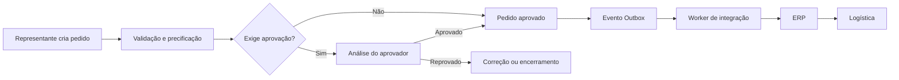
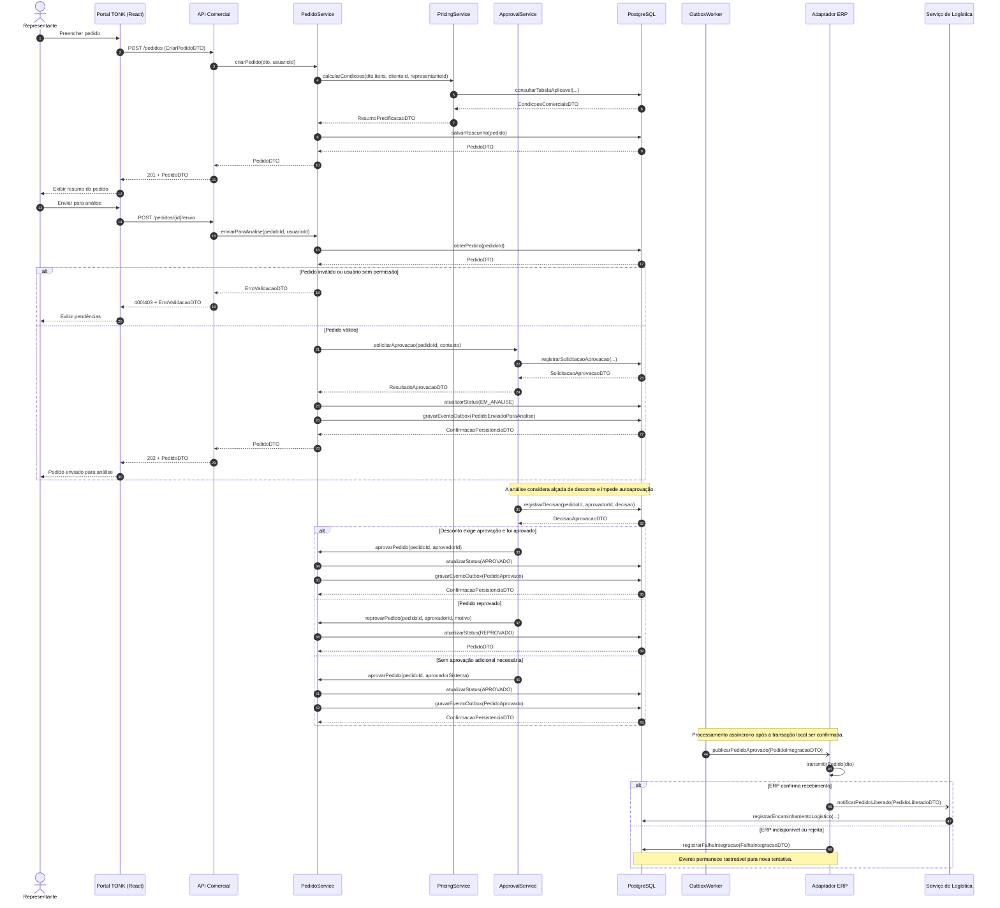
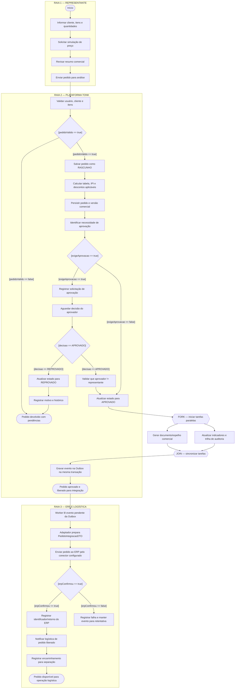
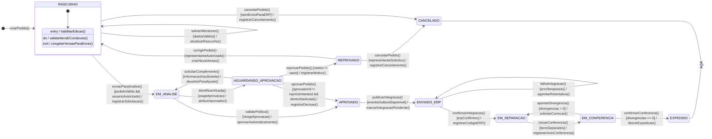

# APS 3 — Dossiê de Arquitetura Viva e Modelagem Comportamental as-Code

**Unidade curricular:** Modelagem de Software  
**Curso:** Engenharia de Software — 4º período  
**Instituição:** UniSenai  
**Acadêmico:** Miguel Maester Ferreira  
**Projeto:** TONK — Plataforma de Gestão Comercial  
**Funcionalidade modelada:** ciclo de vida, aprovação e integração de pedidos comerciais

---

## 1. Apresentação do projeto

Este dossiê apresenta a modelagem de uma funcionalidade crítica da Plataforma TONK: o fluxo de um pedido comercial, desde o cadastro realizado pelo representante até a aprovação, integração com o ERP e encaminhamento para a operação logística.

A proposta considera uma plataforma utilizada por representantes e equipes internas da TONK. O pedido precisa respeitar as condições comerciais aplicáveis, como tabela de preço, cliente, representante, região, descontos e IPI por produto. Quando a negociação ultrapassa uma alçada configurada, o pedido segue para análise de um aprovador autorizado.

O objetivo da modelagem é deixar explícitas as responsabilidades, as mensagens trocadas, as decisões do processo e os estados permitidos para o pedido. Os diagramas foram escritos em Mermaid e Structurizr DSL para que possam ser versionados junto com a documentação.

> **Delimitação:** este material representa uma proposta de arquitetura e comportamento para a funcionalidade. A integração real com o Protheus depende do levantamento do contrato técnico, endpoints, autenticação e formato de dados disponibilizados pela TONK. Esses detalhes não são presumidos neste trabalho.

## 2. Escopo e regras consideradas

- O representante cria e edita o pedido enquanto ele está em rascunho.
- A plataforma calcula as condições comerciais antes do envio para análise.
- As regras de preço consideram a hierarquia comercial configurada e o IPI aplicável a cada produto.
- Pedidos que exigem aprovação não podem seguir para integração antes da decisão.
- O representante não pode aprovar o próprio pedido.
- A decisão de aprovação ou reprovação deve registrar responsável, data e justificativa quando aplicável.
- A versão comercial aprovada deve permanecer preservada. Alterações posteriores exigem novo ciclo/versão.
- A integração com o ERP é assíncrona e rastreável.
- A logística recebe o pedido somente depois da confirmação da integração, conforme o fluxo proposto.

## 3. Visão geral do fluxo



## 4. Artefato 1 — Diagrama de Sequência

O diagrama mostra a ordem das mensagens entre representante, portal, API, serviços de domínio, banco de dados, worker, ERP e logística.

As setas `->>` representam chamadas síncronas. As setas `-)` representam publicação assíncrona. Os retornos incluem DTOs para deixar explícitos os dados trocados entre as operações. O fragmento `alt/else` apresenta o tratamento de pedido inválido, aprovação/reprovação e falha de integração.

**Arquivo-fonte:** [`docs/diagrams/sequencia.mmd`](docs/diagrams/sequencia.mmd)



### Operações públicas consideradas

| Destino | Operações representadas |
|---|---|
| `PedidoService` | `criarPedido`, `enviarParaAnalise`, `aprovarPedido`, `reprovarPedido` |
| `PricingService` | `calcularCondicoes` |
| `ApprovalService` | `solicitarAprovacao`, `registrarDecisao` |
| Repositório/DB | `consultarTabelaAplicavel`, `salvarRascunho`, `obterPedido`, `atualizarStatus`, `gravarEventoOutbox`, `registrarSolicitacaoAprovacao` |
| Adaptador ERP | `publicarPedidoAprovado`, `transmitirPedido` |
| Serviço de Logística | `notificarPedidoLiberado`, `registrarEncaminhamentoLogistico` |

Os nomes acima definem o contrato conceitual das operações da modelagem. Na implementação, devem corresponder aos métodos públicos efetivamente criados nas classes ou interfaces.

## 5. Artefato 2 — Diagrama de Atividades com Raias

O fluxo foi separado em três raias: representante, plataforma TONK e ERP/logística. As condições de guarda foram escritas de forma explícita e mutuamente exclusivas em cada decisão. Depois da aprovação, duas tarefas independentes são executadas em paralelo e sincronizadas antes da gravação do evento de integração.

**Arquivo-fonte:** [`docs/diagrams/atividades.mmd`](docs/diagrams/atividades.mmd)



**Leitura do paralelismo:** após a aprovação, a plataforma pode gerar o espelho comercial e atualizar indicadores/trilha de auditoria em paralelo. O nó JOIN representa a sincronização dessas tarefas antes de concluir a etapa local e disponibilizar o evento para integração. A gravação do pedido aprovado e do evento Outbox deve ocorrer na mesma transação.

## 6. Artefato 3 — Diagrama de Transição de Estados

A entidade principal é `PedidoComercial`. O diagrama mostra o ciclo de vida permitido, desde a criação até a expedição ou cancelamento. As transições incluem gatilho, condição de guarda e ação de efeito.

**Arquivo-fonte:** [`docs/diagrams/estados.mmd`](docs/diagrams/estados.mmd)



**Regras importantes:** não existe transição direta de `RASCUNHO` para `APROVADO` sem validação; pedidos que exigem alçada aguardam decisão; o aprovador não pode ser o próprio representante; uma falha temporária no ERP não apaga a aprovação, apenas mantém a integração pendente para retentativa.

## 7. Artefato 4 — Visão Arquitetural Macro C4

Foi escolhida a **Visão de Contêineres (C4 — Nível 2)**. Ela apresenta as principais unidades executáveis/de implantação, suas responsabilidades e as relações entre elas.

**Arquivo-fonte:** [`docs/architecture/workspace.dsl`](docs/architecture/workspace.dsl)

### Resumo dos contêineres

| Contêiner | Tecnologia proposta | Responsabilidade |
|---|---|---|
| Portal Web/PWA | React, TypeScript, Vite, Tailwind CSS | Interface para representantes e equipes internas |
| API Comercial | Node.js, TypeScript, REST/HTTPS | Regras de negócio, autorização, pedidos e workflow |
| Worker de Integração | Node.js, TypeScript | Processamento assíncrono da Outbox e retentativas |
| Banco de Dados | PostgreSQL (Supabase) | Pedidos, versões, permissões, tabelas e eventos |
| Armazenamento | Supabase Storage | Documentos e arquivos associados |

O ERP Protheus e a operação logística aparecem como sistemas/atores externos. A comunicação com o ERP está representada como uma fronteira de integração cujo protocolo e contrato final ainda precisam ser confirmados. O uso de HTTPS no conector é uma proposta de transporte, não uma afirmação sobre a API já existente no Protheus.

### Como visualizar o C4

O arquivo `workspace.dsl` utiliza Structurizr DSL. Para renderizar, abra o Structurizr Lite ou o Structurizr DSL online e carregue o conteúdo do arquivo. A visão `Containers` representa o nível 2 do C4.

## 8. Artefato 5 — Registro de Decisão Arquitetural (ADR 0001)

**Arquivo-fonte:** [`docs/architecture/adr-0001.md`](docs/architecture/adr-0001.md)

A decisão registrada foi utilizar o padrão **Transactional Outbox** para a integração assíncrona de pedidos aprovados.

A escolha resolve um problema importante: a plataforma não deve perder um pedido aprovado caso o ERP esteja indisponível no momento do envio. O pedido e o evento de integração são gravados na mesma transação; um worker processa o evento posteriormente e registra o resultado.

A decisão também considera retentativas, idempotência, rastreabilidade e o fato de que o contrato técnico real do Protheus ainda precisa ser levantado.

## 9. Consistência entre os artefatos

| Conceito | Sequência | Atividades | Estados | C4/ADR |
|---|---|---|---|---|
| Criação e validação | `criarPedido` | Informar e validar pedido | `RASCUNHO` | API Comercial |
| Precificação | `calcularCondicoes` | Calcular tabela, IPI e desconto | Validação em rascunho | API e banco |
| Aprovação | `solicitarAprovacao`, `aprovarPedido`, `reprovarPedido` | Decisão do aprovador | `EM_ANALISE`, `AGUARDANDO_APROVACAO`, `APROVADO`, `REPROVADO` | Regras da API |
| Integração | `publicarPedidoAprovado` | Worker envia evento | `ENVIADO_ERP` | Worker, Outbox e ERP |
| Logística | `notificarPedidoLiberado` | Encaminhar para separação | `EM_SEPARACAO`, `EM_CONFERENCIA`, `EXPEDIDO` | ERP e operação logística |

## 10. Decisões e limitações do modelo

1. A solução é modelada para uma implantação inicial na TONK, sem impedir evolução futura para múltiplas empresas.
2. As permissões devem ser aplicadas no back-end e no banco de dados, não apenas por ocultação de botões na interface.
3. O histórico de aprovação e a versão comercial aprovada precisam ser preservados.
4. A integração com o Protheus depende de documentação e validação técnica do ambiente real.
5. O fluxo logístico apresentado é uma proposta de processo. Os eventos e estados podem ser ajustados após validação com a equipe de operação.
6. Os diagramas são modelos declarativos e devem evoluir junto com a implementação para reduzir a deriva arquitetural.

## 11. Como validar os arquivos

- Conferir os três arquivos `.mmd` em um renderizador Mermaid.
- Conferir `workspace.dsl` em um renderizador Structurizr DSL.
- Conferir se os nomes de operações do diagrama de sequência permanecem coerentes com os serviços descritos.
- Revisar as condições de guarda e os estados com o professor ou com a equipe do projeto antes de considerar o modelo como arquitetura implementada.

## 12. Roteiro curto para apresentação

**1. Qual funcionalidade foi escolhida?**  
Escolhi o ciclo de vida e a aprovação de pedidos comerciais da TONK, porque um pedido envolve preço, desconto, autorização, integração com ERP e logística. Um erro nessa sequência pode gerar divergência comercial ou operacional.

**2. O que o diagrama de sequência mostra?**  
Ele mostra quem conversa com quem e em qual ordem. As chamadas síncronas são usadas para validar e registrar o pedido. Depois da aprovação, a integração é assíncrona, então o representante não precisa ficar esperando o ERP responder para concluir a operação na plataforma.

**3. Onde aparece a concorrência no diagrama de atividades?**  
Depois da aprovação, a geração do documento comercial e a atualização dos indicadores/trilha de auditoria podem ocorrer em paralelo. O JOIN sincroniza essas tarefas antes da etapa seguinte.

**4. Por que existe uma máquina de estados?**  
Para impedir que o pedido pule etapas. Por exemplo, um pedido que exige aprovação não pode ir direto para o ERP. Também é possível representar falhas temporárias de integração sem perder o estado de aprovação.

**5. Por que foi escolhida a Outbox?**  
Porque a alteração do pedido para aprovado e o registro do evento de integração precisam ser consistentes. Se tudo for gravado na mesma transação, o worker consegue localizar o evento depois, mesmo que o ERP esteja indisponível naquele momento.

**6. A integração com o Protheus já está definida?**  
Não. O modelo prevê um adaptador para isolar a integração, mas o endpoint, a autenticação e o formato dos dados precisam ser confirmados com a equipe responsável pelo ERP.

---

## 13. Entrega e versionamento no GitHub

A estrutura do repositório segue a organização solicitada na folha de instruções:

```text
aps3-miguel-maester-ferreira/
├── docs/
│   ├── architecture/
│   │   ├── workspace.dsl
│   │   └── adr-0001.md
│   └── diagrams/
│       ├── sequencia.mmd
│       ├── atividades.mmd
│       └── estados.mmd
└── README.md
```

### Comandos para publicar

Depois de criar um repositório vazio no GitHub, abra o terminal dentro da pasta do projeto e execute:

```bash
git init
git add .
git commit -m "docs: adiciona dossie de arquitetura viva da APS 3"
git branch -M main
git remote add origin https://github.com/SEU-USUARIO/aps3-miguel-maester-ferreira.git
git push -u origin main
```

Substitua `SEU-USUARIO` pelo seu usuário real do GitHub. Depois, copie o endereço do repositório e envie o link no AVA.

### Histórico de evolução

A folha de instruções informa que os commits serão auditados. Por isso, não apresente um histórico artificial. Se ainda estiver desenvolvendo o trabalho, faça alterações reais, valide os diagramas e registre cada etapa com mensagens que descrevam o que foi feito. Exemplo:

```bash
git add docs/diagrams/sequencia.mmd
git commit -m "docs: modela interacoes do fluxo de pedidos"

git add docs/diagrams/atividades.mmd
git commit -m "docs: detalha raias e tarefas paralelas"

git add docs/diagrams/estados.mmd
git commit -m "docs: define estados e transicoes do pedido"

git add docs/architecture/
git commit -m "docs: registra visao C4 e decisao arquitetural"

git add README.md
git commit -m "docs: organiza dossie e roteiro de apresentacao"

git push
```

**Importante:** esses commits devem ser feitos conforme você realmente revisar e concluir cada parte, e não usados para simular datas ou uma evolução que não aconteceu.
